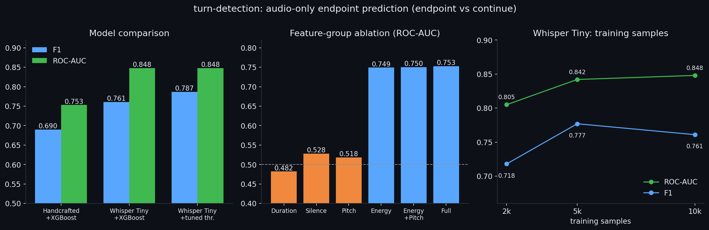
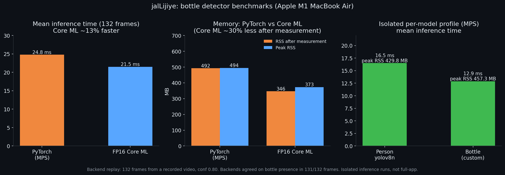

# Prateek Mehra

## Experiments and benchmarks

### [turn-detection](https://github.com/prateek-mehra/turn-detection)
Audio-only endpoint detection (has the speaker finished their turn?). Frozen Whisper Tiny embeddings + XGBoost beat handcrafted acoustic features: ROC-AUC 0.753 to 0.848, F1 0.690 to 0.787 after threshold tuning. Ablation shows energy features carry almost all the signal of the handcrafted set.

  

### [jalLijiye](https://github.com/prateek-mehra/jalLijiye)
Edge-inference optimization for the bottle detector on an Apple M1 MacBook Air. FP16 Core ML vs PyTorch on MPS over the same 132 frames: 21.5 vs 24.8 ms/frame, about 30% less memory after measurement, bottle presence agreed on 131/132 frames. Isolated inference runs, not full-app.

  

## Checkout my live projects

[Where did I apply](https://github.com/prateek-mehra/where-did-i-apply): Chrome extension for job application tracking over different platforms. [Install from the Chrome Web Store](https://chromewebstore.google.com/detail/bhceempigapankbmnhjapcpdnbmiiahl).

  

---

## Stack

Python | C++ | Docker | Linux | AWS | GCP  
Experience with Kubernetes, Postgres, system-level debugging, and cloud-native ML systems.

---

## Contact

LinkedIn: https://www.linkedin.com/in/1prateekmehra1/  
Email: partumehra@gmail.com
